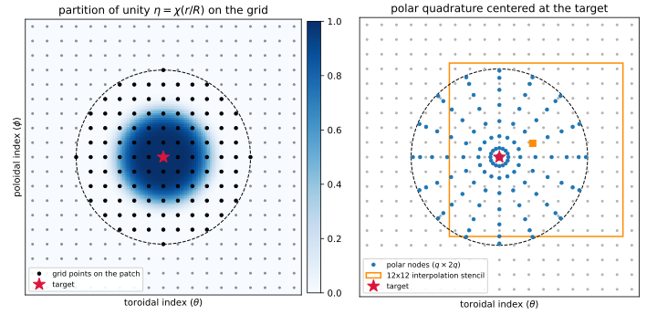

..
   Copyright (C) 2018-2026 The Simons Foundation, Inc. and the BIEST authors (see NOTICE)
   Author: Dhairya Malhotra
   SPDX-License-Identifier: Apache-2.0

.. _algorithms-singular-quadrature:

Singular Quadrature
===================

Every solver in BIEST spends most of its time evaluating layer potentials

.. math::

   u(\mathbf{x}_0) = \int_\Gamma K(\mathbf{x}_0 - \mathbf{y})\, f(\mathbf{y})\,\mathrm{d}a(\mathbf{y})
   = \int_{[0,2\pi)^2} K(\mathbf{x}_0 - \mathbf{x}(\theta,\phi))\, f(\theta,\phi)\, \sqrt{\det\mathbf{G}}\,\mathrm{d}\theta\,\mathrm{d}\phi

at the grid points :math:`\mathbf{x}_0` of the surface. The kernel is singular at :math:`\mathbf{y} = \mathbf{x}_0`:
weakly singular (:math:`\sim 1/r`, for example the single layer :math:`g_k`) or of principal-value type
(:math:`\sim 1/r^2`, for example :math:`\nabla g_k`, the double layer and the Biot--Savart kernel).
The trapezoidal rule, which is spectrally accurate for smooth periodic integrands, is not accurate for these integrals.
The standard method in fusion codes (singularity subtraction, as in NESTOR) leaves an integrand with a jump and
converges at second order ([MCOT2020]_, Sec. 3.1). BIEST uses a high-order method that converges spectrally
([MCIO2019]_, Sec. 3.2; [MCOT2020]_, Sec. 3.2), based on the methods of Bruno and Kunyansky and of Ying, Biros and Zorin.
It is implemented in ``BoundaryIntegralOp`` (with the class ``SingularCorrection``).

Partition of unity
------------------

For each target point :math:`\mathbf{x}_0 = \mathbf{x}(\theta_0,\phi_0)`, the integral is split with a smooth function
:math:`\eta` that equals 1 near the target and vanishes away from it:

.. math::

   u(\mathbf{x}_0) =
   \underbrace{\int (1-\eta)\, K f \sqrt{\det\mathbf{G}}\,\mathrm{d}\theta\,\mathrm{d}\phi}_{\text{smooth part}}
   \;+\;
   \underbrace{\int \eta\, K f \sqrt{\det\mathbf{G}}\,\mathrm{d}\theta\,\mathrm{d}\phi}_{\text{singular part}} .

The function :math:`\eta` is defined in grid-index space,

.. math::

   \eta(\theta,\phi) = \chi\!\left(\frac{1}{R}\sqrt{\left(\frac{\theta-\theta_0}{h_\theta}\right)^2 + \left(\frac{\phi-\phi_0}{h_\phi}\right)^2}\right),
   \qquad \chi(\rho) = \exp\left(-36\,\rho^{p}\right),

where :math:`h_\theta = 2\pi/N_\theta` and :math:`h_\phi = 2\pi/N_\phi` are the grid spacings and :math:`R` is the
radius of the patch in grid spacings: the template parameter ``PATCH_DIM0``, or :math:`M/2` in the notation of the
papers. Since :math:`\chi(1) = e^{-36} \approx 2\times 10^{-16}`, :math:`\eta` vanishes to double-precision accuracy
outside a disc of radius :math:`R` grid spacings, which lies inside a square patch of
:math:`(2R+1)\times(2R+1)` grid points. The exponent is :math:`p = 8` in [MCIO2019]_; the code uses :math:`p = 6`, 8 or 10
for patches of width up to 20, up to 45 and above 45 grid points.
Compared to the function of Bruno and Kunyansky, this :math:`\chi` stays close to 1 over a larger part of the
disc, so that :math:`(1-\eta)K` is smoother, and its Fourier coefficients decay faster, so that fewer grid points
resolve it ([MCIO2019]_, Fig. 4).

   Left: the partition of unity :math:`\eta` on the grid around a target point, with patch radius :math:`R = 6`.
   Right: the polar quadrature nodes (:math:`q = 8`), and the :math:`12\times 12` block of grid points from which
   the values at one polar node (orange square) are interpolated.

Smooth part
-----------

The integrand :math:`(1-\eta)Kf\sqrt{\det\mathbf{G}}` is smooth and periodic, so the trapezoidal rule converges
spectrally, provided that :math:`\eta` is resolved on the grid. BIEST computes it as the full trapezoidal sum over all
grid points, minus the trapezoidal sum of :math:`\eta K f \sqrt{\det\mathbf{G}}` over the patch:

.. math::

   \sum_{\text{all } (i,j)} K_{ij}\,\mathsf{f}_{ij}\,\mathsf{w}_{ij} \;-\; \sum_{(i,j)\in\text{patch}} \eta_{ij}\,K_{ij}\,\mathsf{f}_{ij}\,\mathsf{w}_{ij},

where the kernel is taken to be zero at :math:`\mathbf{y} = \mathbf{x}_0`. The full sum is the same for all targets,
an :math:`N`-body sum that BIEST evaluates by direct summation, vectorized with SIMD instructions and parallelized
over the targets. It costs :math:`\mathcal{O}(N^2)`; [MCIO2019]_ notes that a fast multipole method would reduce this
to :math:`\mathcal{O}(N)`, but would not pay off at the problem sizes considered.

Singular part
-------------

The singular part is computed in polar coordinates :math:`(\rho,\omega)` centered at the target, in grid-index space:

.. math::

   \theta = \theta_0 + R\,h_\theta\,\rho\cos\omega,\qquad
   \phi = \phi_0 + R\,h_\phi\,\rho\sin\omega,\qquad
   \int \eta K f \sqrt{\det\mathbf{G}}\,\mathrm{d}\theta\,\mathrm{d}\phi =
   \int_0^{2\pi}\!\!\int_0^1 \chi(\rho)\, K f \sqrt{\det\mathbf{G}}\; R^2 h_\theta h_\phi\,\rho\,\mathrm{d}\rho\,\mathrm{d}\omega .

The factor :math:`\rho` from the change of variables cancels a :math:`1/r` singularity, so for weakly singular
kernels the integrand is bounded. For principal-value kernels, the singular part of the integrand is odd in
:math:`\omega \mapsto \omega + \pi`, and a quadrature rule that is symmetric under this map integrates it to zero.
BIEST uses the tensor product of the trapezoidal rule with :math:`2q` points in :math:`\omega` and the
Gauss--Legendre rule with :math:`q` points in :math:`\rho\in[0,1]`, where :math:`q` is the template parameter
``RAD_DIM``. Because the radial rule does not need the integrand to be smooth at :math:`\rho = 0`, kernels with a
bounded but non-smooth part (such as :math:`\operatorname{Im} g_k`) are integrated accurately as well.
(In the notation of [MCIO2019]_ this is a rule with :math:`q` trapezoidal points in :math:`\omega\in[0,\pi)` and :math:`q`
Gauss--Legendre points on each half of :math:`\rho\in[-1,1]`: the same :math:`2q^2` nodes.)

The polar nodes are not grid points. The surface coordinates and the tangent vectors
:math:`\mathbf{x}_\theta,\mathbf{x}_\phi` are interpolated to them with tensor-product Lagrange interpolation on a
:math:`12\times 12` block of grid points around each node, and the normal and the area element are recomputed from the
interpolated tangent vectors (interpolating the normals directly is less accurate).

Precomputed sparse correction
-----------------------------

The density :math:`f` is interpolated to the polar nodes with the same interpolation matrix
:math:`\mathbf{L}`, so the polar quadrature is a linear function of the density values on the patch.
For each target, BIEST precomputes the weights

.. math::

   \mathsf{M}_{ij} = -\,\eta_{ij}\, K(\mathbf{x}_0 - \mathbf{x}_{ij})\,\mathsf{w}_{ij}
   \;+\; \sum_{k} L_{k,ij}\;\chi(\rho_k)\, K(\mathbf{x}_0 - \mathbf{x}_k)\,\sqrt{\det\mathbf{G}_k}\,R^2 h_\theta h_\phi\,\rho_k\,\mathsf{w}_k ,
   \qquad (i,j) \in \text{patch},

where :math:`k` runs over the polar nodes with weights :math:`\mathsf{w}_k`. The layer potential is then

.. math::

   u(\mathbf{x}_0) \approx \sum_{\text{all } (i,j)} K_{ij}\,\mathsf{f}_{ij}\,\mathsf{w}_{ij} + \sum_{(i,j)\in\text{patch}} \mathsf{M}_{ij}\,\mathsf{f}_{ij} :

the trapezoidal rule plus a correction that acts only on the :math:`(2R+1)^2` grid points near the target.

- **Setup** (``SetupSingular``): :math:`\mathcal{O}(q^2)` kernel evaluations and interpolations per target, done
  once for a given surface and kernel.
- **Evaluation** (``operator()``): the :math:`\mathcal{O}(N^2)` trapezoidal sum, plus :math:`\mathcal{O}(R^2)` operations
  per target for the correction. No kernel evaluation or interpolation of the density is needed for the correction,
  which matters when the operator is applied many times inside GMRES.
- **Memory**: :math:`k_0 k_1 (2R+1)^2` numbers per target, for a kernel with :math:`k_0` density and :math:`k_1`
  potential components. For example, 173 KB per target for the Biot--Savart kernel with :math:`R = 24`.

Upsampling
----------

The template parameter ``UPSAMPLE`` upsamples the surface and the density by this factor in each direction (with
the FFT) before applying the quadrature; the targets remain the original grid points. The patch radius :math:`R`
is measured in grid spacings of the upsampled grid. Upsampling helps when the density and the surface are resolved
on the original grid but the integrand :math:`(1-\eta)Kf` is not.
Each direction of the (upsampled) grid must have at least :math:`2R+1` points.

.. _algorithms-quadrature-params:

Choosing the parameters
-----------------------

The patch radius :math:`R` and the order :math:`q` must grow with the grid size :math:`N` for the quadrature to
converge; [MCIO2019]_ (following Ying, Biros and Zorin) suggests :math:`R, q = \mathcal{O}(N^{1/4})`, with the
constants found empirically. The table lists the values of [MCIO2019]_ (Table 3) for the Green's identity test on the
QAS3 stellarator, with the relative error of the Laplace (:math:`\lambda = 0`) and Helmholtz (:math:`\lambda = 1`)
layer potentials:

.. list-table::
   :header-rows: 1
   :widths: 20 15 20 15 15 15

   * - Grid :math:`N_\theta\times N_\phi`
     - :math:`N`
     - ``PATCH_DIM0`` (:math:`R`)
     - ``RAD_DIM`` (:math:`q`)
     - Error (Laplace)
     - Error (Helmholtz)
   * - :math:`70\times 14`
     - 980
     - 6
     - 15
     - 2.0e-3
     - 2.6e-3
   * - :math:`140\times 28`
     - 3920
     - 12
     - 24
     - 3.9e-5
     - 1.5e-4
   * - :math:`280\times 56`
     - 15680
     - 15
     - 30
     - 1.2e-6
     - 4.0e-6
   * - :math:`490\times 98`
     - 48020
     - 20
     - 36
     - 4.3e-8
     - 1.1e-7
   * - :math:`700\times 140`
     - 98000
     - 25
     - 42
     - 3.3e-9
     - 7.2e-9

The programs ``src/table3.cpp``, ``src/table5.cpp``, ``src/table6.cpp`` and ``src/table7.cpp`` list the parameters
used for the other results in the paper. In the test of [MCOT2020]_ (Fig. 2), the method converges at roughly
12th order on an axisymmetric torus and 10th order on W7-X, while singularity subtraction converges at second order.

``FieldPeriodBIOp`` chooses the parameters at run time from the requested number of digits :math:`d`:

1. It measures how much the ratio of the toroidal to the poloidal grid spacing varies over the surface,
   :math:`c = \sqrt{s_{max}/s_{min}}`, where :math:`s` is that ratio at a grid point (a warning is printed if
   :math:`c > 4`).
2. It sets :math:`R` to the largest value in :math:`\{6, 8, 12, 16, 20, \ldots, 64\}` that does not exceed
   :math:`1.6\,d\,c`, and :math:`q = \lfloor 1.6 R \rfloor`.
3. It chooses a quadrature grid with spacings of about the same size in the two directions, at least as fine as the
   surface, the density and the patch require. It then refines this grid up to three times, until the Laplace double
   layer of a constant density (which equals :math:`-1/2` on the surface) is accurate to :math:`d` digits.

.. _algorithms-off-surface:

Off-surface evaluation
----------------------

The fields are also needed at points off the surface, for example at points inside the plasma, or along field lines
that come close to the boundary. Far from the surface, the trapezoidal rule (on an upsampled grid) is accurate,
but near the surface the integrand is sharply peaked and the required upsampling becomes very large ([MCIO2019]_,
Sec. 3.1.5). BIEST evaluates off-surface fields with ``OffSurfaceOp`` (used by all ``EvalOffSurface`` methods),
which handles targets at any distance from the surface:

1. The surface is divided into quadrilateral panels, each with a :math:`12\times 12` tensor grid of Gauss--Legendre
   nodes. Starting from a coarse :math:`4\times 4` mesh in the grid parameters, each panel is split in half along
   the toroidal direction, the poloidal direction or both, until on every panel the last two Legendre coefficients
   along each direction of the surface coordinates, of their derivatives (which give the normal and the area element)
   and of the densities are below the requested tolerance, relative to the largest value of each field. The panels
   are therefore small only where the surface or the densities vary rapidly. A panel is not split beyond 16 nodes per
   grid point.
2. The surface coordinates and the densities are interpolated from the periodic grid to the panel nodes: first FFT
   upsampling (by a factor up to 16, chosen to meet the tolerance on the finest panels), then local 12-point Lagrange
   interpolation.
3. The layer potential at the targets is computed with the boundary integral operator of SCTL on these panels,
   which uses adaptive quadrature for targets close to a panel
   (see `QuadElemList <https://sctl.readthedocs.io/en/latest/algorithms/quad-element.html>`_ in SCTL).

Warnings are printed if the grid does not resolve the surface or the densities to the requested accuracy. The
targets must not lie on the surface.

Hedgehog quadrature (``HedgehogOrder``)
---------------------------------------

The operators have a template parameter ``HedgehogOrder``. The value 1 (the default, and also 0) gives the method
above. A value :math:`H > 1` evaluates the polar part at :math:`H` points along the normal on the side opposite to
the normal (inside, for outward normals), and extrapolates the result back to the surface. This computes the one-sided
limit of the layer potential from that side, instead of the principal value. The solvers do not use it.
