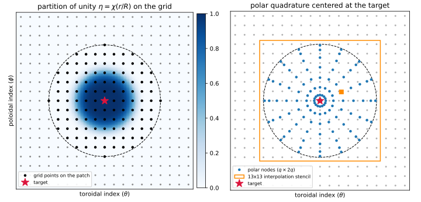

..
   Copyright (C) 2018-2026 The Simons Foundation, Inc. and the BIEST authors (see NOTICE)
   Author: Dhairya Malhotra
   SPDX-License-Identifier: Apache-2.0

.. _algorithms-singular-quadrature:

Singular Quadrature
===================

Every solver in BIEST spends most of its time evaluating layer potentials

.. math::

   u(\mathbf{x}_0) = \int_\Gamma K(\mathbf{x}_0 - \mathbf{y})\, f(\mathbf{y})\,\mathrm{d}a(\mathbf{y})
   = \int_{[0,2\pi)^2} K(\mathbf{x}_0 - \mathbf{x}(\theta,\phi))\, f(\theta,\phi)\, \sqrt{\det\mathbf{G}}\,\mathrm{d}\theta\,\mathrm{d}\phi

at the grid points :math:`\mathbf{x}_0` of the surface. The kernel is singular at :math:`\mathbf{y} = \mathbf{x}_0`:
weakly singular (:math:`\sim 1/r`, for example the single layer :math:`g_k`) or of principal-value type
(:math:`\sim 1/r^2`, for example :math:`\nabla g_k`, the double layer and the Biot--Savart kernel).
The trapezoidal rule, which is spectrally accurate for smooth periodic integrands, is not accurate for these integrals.
The standard method in fusion codes (singularity subtraction, as in NESTOR) leaves an integrand with a jump and
converges at second order ([MCOT2020]_, Sec. 3.1). BIEST uses a high-order method that converges spectrally
([MCIO2019]_, Sec. 3.2; [MCOT2020]_, Sec. 3.2), based on the methods of Bruno and Kunyansky and of Ying, Biros and Zorin.
It is implemented in ``BoundaryIntegralOp`` (with the class ``SingularCorrection``).

Partition of unity
------------------

For each target point :math:`\mathbf{x}_0 = \mathbf{x}(\theta_0,\phi_0)`, the integral is split with a smooth function
:math:`\eta` that equals 1 near the target and vanishes away from it:

.. math::

   u(\mathbf{x}_0) =
   \underbrace{\int (1-\eta)\, K f \sqrt{\det\mathbf{G}}\,\mathrm{d}\theta\,\mathrm{d}\phi}_{\text{smooth part}}
   \;+\;
   \underbrace{\int \eta\, K f \sqrt{\det\mathbf{G}}\,\mathrm{d}\theta\,\mathrm{d}\phi}_{\text{singular part}} .

The function :math:`\eta` is defined in grid-index space,

.. math::

   \eta(\theta,\phi) = \chi\!\left(\frac{1}{R}\sqrt{\left(\frac{\theta-\theta_0}{h_\theta}\right)^2 + \left(\frac{\phi-\phi_0}{h_\phi}\right)^2}\right),
   \qquad \chi(\rho) = \exp\left(-36\,\rho^{p}\right),

where :math:`h_\theta = 2\pi/N_\theta` and :math:`h_\phi = 2\pi/N_\phi` are the grid spacings and :math:`R` is the
radius of the patch in grid spacings: ``patch_rad`` of ``SingularQuadParams``, or :math:`M/2` in the notation of the
papers. Since :math:`\chi(1) = e^{-36} \approx 2\times 10^{-16}`, :math:`\eta` vanishes to double-precision accuracy
outside a disc of radius :math:`R` grid spacings, which lies inside a square patch of
:math:`(2R+1)\times(2R+1)` grid points. The exponent is :math:`p = 8` in [MCIO2019]_; the code uses :math:`p = 6`, 8 or 10
for patches of width up to 20, up to 45 and above 45 grid points.
Compared to the function of Bruno and Kunyansky, this :math:`\chi` stays close to 1 over a larger part of the
disc, so that :math:`(1-\eta)K` is smoother, and its Fourier coefficients decay faster, so that fewer grid points
resolve it ([MCIO2019]_, Fig. 4).

   Left: the partition of unity :math:`\eta` on the grid around a target point, with patch radius :math:`R = 6`.
   Right: the polar quadrature nodes (:math:`q = 8`), and the :math:`12\times 12` block of grid points from which
   the values at one polar node (orange square) are interpolated.

Smooth part
-----------

The integrand :math:`(1-\eta)Kf\sqrt{\det\mathbf{G}}` is smooth and periodic, so the trapezoidal rule converges
spectrally, provided that :math:`\eta` is resolved on the grid. BIEST computes it as the full trapezoidal sum over all
grid points, minus the trapezoidal sum of :math:`\eta K f \sqrt{\det\mathbf{G}}` over the patch:

.. math::

   \sum_{\text{all } (i,j)} K_{ij}\,\mathsf{f}_{ij}\,\mathsf{w}_{ij} \;-\; \sum_{(i,j)\in\text{patch}} \eta_{ij}\,K_{ij}\,\mathsf{f}_{ij}\,\mathsf{w}_{ij},

where the kernel is taken to be zero at :math:`\mathbf{y} = \mathbf{x}_0`. The full sum is the same for all targets,
an :math:`N`-body sum that BIEST evaluates by direct summation, vectorized with SIMD instructions and parallelized
over the targets. It costs :math:`\mathcal{O}(N^2)`; [MCIO2019]_ notes that a fast multipole method would reduce this
to :math:`\mathcal{O}(N)`, but would not pay off at the problem sizes considered.

Singular part
-------------

The singular part is computed in polar coordinates :math:`(\rho,\omega)` centered at the target, in grid-index space:

.. math::

   \theta = \theta_0 + R\,h_\theta\,\rho\cos\omega,\qquad
   \phi = \phi_0 + R\,h_\phi\,\rho\sin\omega,\qquad
   \int \eta K f \sqrt{\det\mathbf{G}}\,\mathrm{d}\theta\,\mathrm{d}\phi =
   \int_0^{2\pi}\!\!\int_0^1 \chi(\rho)\, K f \sqrt{\det\mathbf{G}}\; R^2 h_\theta h_\phi\,\rho\,\mathrm{d}\rho\,\mathrm{d}\omega .

The factor :math:`\rho` from the change of variables cancels a :math:`1/r` singularity, so for weakly singular
kernels the integrand is bounded. For principal-value kernels, the singular part of the integrand is odd in
:math:`\omega \mapsto \omega + \pi`, and a quadrature rule that is symmetric under this map integrates it to zero.
BIEST uses the tensor product of the trapezoidal rule with :math:`n_\omega` points in :math:`\omega` (an even number, so
that the rule has this symmetry) and the Gauss--Legendre rule with :math:`n_\rho` points in :math:`\rho\in[0,1]`:
``ang_nodes`` and ``rad_nodes`` of ``SingularQuadParams``. Because the radial rule does not need the integrand to be
smooth at :math:`\rho = 0`, kernels with a bounded but non-smooth part (such as :math:`\operatorname{Im} g_k`) are
integrated accurately as well. (The rule of [MCIO2019]_, with :math:`q` trapezoidal points in :math:`\omega\in[0,\pi)`
and :math:`q` Gauss--Legendre points on each half of :math:`\rho\in[-1,1]`, is that with :math:`n_\rho = q` and
:math:`n_\omega = 2q`.)

The polar nodes are not grid points. The surface coordinates and the tangent vectors
:math:`\mathbf{x}_\theta,\mathbf{x}_\phi` are interpolated to them with tensor-product Lagrange interpolation on a
:math:`16\times 16` block of grid points around each node (the whole patch when it is narrower), and the normal and the
area element are recomputed from the interpolated tangent vectors (interpolating the normals directly is less accurate).
The gradient and the Hessian of the single layer need this order for a density that is not constant: with a
:math:`12\times 12` block, in the test of virtual-casing at 12 digits, they were 1.0 and 1.4 digits less accurate.

The :math:`n_\omega` angles are set by the kernel, which varies with :math:`\omega` the more the grid is anisotropic (see
:ref:`Choosing the parameters <algorithms-quadrature-params>`); the data on a circle of radius :math:`\rho R` grid
spacings, as far as the grid resolves it, has angular frequencies only to about :math:`\pi\rho R`. So the Lagrange
interpolation is to :math:`2m+2 \le n_\omega` equispaced angles on each circle, with
:math:`m = \lceil \pi\rho R\rceil + 6`, and the values at the :math:`n_\omega` angles are the trigonometric interpolant
of those (the matrix of the periodic sinc kernel); the correction weights go back by the transpose. An even number of
angles keeps them symmetric under :math:`\omega \mapsto \omega + \pi`, as the polar nodes are: with an odd number,
the field of a surface with stellarator symmetry lost that symmetry at the level of the quadrature error. The interpolation is
most of the setup: with :math:`R = 28`, 44 radii and 88 angles, this is 76% of the polar nodes (62% with the hedgehog
of 132 radii), and on an AMD EPYC 9474F the setup of the gradient of the single layer takes 0.68 ms per target instead
of 0.82 ms, and that of its Hessian 4.6 ms instead of 6.3 ms. Fewer angles, for only the lower frequencies of the grid,
do as well for a smooth density but not inside GMRES, whose Krylov vectors reach the highest: with half of them, the
solves in ``test/bie-solvers.cpp`` take 32% more iterations.

Precomputed sparse correction
-----------------------------

The density :math:`f` is interpolated to the polar nodes with the same interpolation matrix
:math:`\mathbf{L}`, so the polar quadrature is a linear function of the density values on the patch.
For each target, BIEST precomputes the weights

.. math::

   \mathsf{M}_{ij} = -\,\eta_{ij}\, K(\mathbf{x}_0 - \mathbf{x}_{ij})\,\mathsf{w}_{ij}
   \;+\; \sum_{k} L_{k,ij}\;\chi(\rho_k)\, K(\mathbf{x}_0 - \mathbf{x}_k)\,\sqrt{\det\mathbf{G}_k}\,R^2 h_\theta h_\phi\,\rho_k\,\mathsf{w}_k ,
   \qquad (i,j) \in \text{patch},

where :math:`k` runs over the polar nodes with weights :math:`\mathsf{w}_k`. The layer potential is then

.. math::

   u(\mathbf{x}_0) \approx \sum_{\text{all } (i,j)} K_{ij}\,\mathsf{f}_{ij}\,\mathsf{w}_{ij} + \sum_{(i,j)\in\text{patch}} \mathsf{M}_{ij}\,\mathsf{f}_{ij} :

the trapezoidal rule plus a correction that acts only on the :math:`(2R+1)^2` grid points near the target.

- **Setup** (``SetupSingular``): :math:`\mathcal{O}(n_\rho n_\omega)` kernel evaluations and interpolations per target, done
  once for a given surface and kernel.
- **Evaluation** (``operator()``): the :math:`\mathcal{O}(N^2)` trapezoidal sum, plus :math:`\mathcal{O}(R^2)` operations
  per target for the correction. No kernel evaluation or interpolation of the density is needed for the correction,
  which matters when the operator is applied many times inside GMRES.
- **Memory**: :math:`k_0 k_1 (2R+1)^2` numbers per target, for a kernel with :math:`k_0` density and :math:`k_1`
  potential components. For example, 173 KB per target for the Biot--Savart kernel with :math:`R = 24`.

Upsampling
----------

The template parameter ``UPSAMPLE`` upsamples the surface and the density by this factor in each direction (with
the FFT) before applying the quadrature; the targets remain the original grid points. The patch radius :math:`R`
is measured in grid spacings of the upsampled grid. Upsampling helps when the density and the surface are resolved
on the original grid but the integrand :math:`(1-\eta)Kf` is not.
Each direction of the (upsampled) grid must have at least :math:`2R+1` points.

.. _algorithms-quadrature-params:

Choosing the parameters
-----------------------

The patch radius :math:`R` and the polar grid must grow with the requested accuracy for the quadrature error to
decrease. ``BoundaryIntegralOp::SetupSingular()`` chooses them for its tolerance :math:`10^{-d}` and the anisotropy
:math:`c` of the grid of each surface: the largest ratio, over the grid points, of the singular values of the Jacobian of
the surface with respect to the grid indices (:math:`c = 1` for square cells; skewed cells count as well). The rules were
fit to the error of Green's identity for the Laplace single and double layers, with a smooth density, on tori and
rotating ellipses with :math:`c` from 1.3 to 4.4:

- :math:`R = \lceil d\,(1.1 + 0.5\,c)\rceil`. A patch large enough for the polar grid is not enough: the trapezoidal
  rule outside the patch, on :math:`(1-\eta)K`, converges more slowly on an anisotropic grid. For 10 digits,
  :math:`R = 17` was needed for :math:`c = 1.3` and :math:`R = 34` for :math:`c = 4.4`.
- :math:`n_\rho = \lceil 2.6\,d\rceil + 2`, the same for every :math:`c` and :math:`R`: with this many radii the error
  reached :math:`d` digits on every surface, or the limit that :math:`R` set.
- :math:`n_\omega = 2\,(\lceil d / \log_{10}\frac{c+1}{c-1}\rceil + 4)`, with :math:`c` at least 1.2. On a grid of
  anisotropy :math:`c` the kernel, as a function of :math:`\omega`, behaves as
  :math:`(\cos^2\omega + c^2\sin^2\omega)^{-1/2}`, which is analytic in a strip of half-width
  :math:`\frac{1}{2}\ln\frac{c+1}{c-1}`, and the trapezoidal rule converges at that rate: 2.7 angles per digit were
  needed for :math:`c = 1.3` and 10.6 for :math:`c = 4.4`, against 2.4 and 10.0 from the strip.
- With the hedgehog (``HedgehogOrder`` > 1), :math:`R` is 1.3 times larger, :math:`n_\rho = 3\lceil 1.6R\rceil` (the
  radial nodes set how far the points of the hedgehog are from the surface) and :math:`n_\omega` is 1.4 times larger:
  fit to the Hessian of the single layer in the test of virtual-casing.

For a density that the grid resolves only to a few digits, the polar grid of these rules differs from a much finer one
at the same :math:`R` by less than the error of the density itself. Values given in ``SingularQuadParams`` replace the
chosen ones, and a chosen patch is limited to the grid. Earlier versions took :math:`R` as a template parameter, with
:math:`n_\rho = q` and :math:`n_\omega = 2q` for a template parameter :math:`q`; ``FieldPeriodBIOp`` took the largest
:math:`R` in :math:`\{6, 8, 12, 16, \ldots, 64\}` up to :math:`1.6\,d\,c` and :math:`q = \lfloor 1.6R\rfloor`, which
grew with :math:`c` in every direction.

For a fixed tolerance, the quadrature error decreases with the grid only while the density and the surface are not
resolved; [MCIO2019]_ (following Ying, Biros and Zorin) suggests :math:`R, q = \mathcal{O}(N^{1/4})` for convergence with
the grid size :math:`N`. The table lists the values of [MCIO2019]_ (Table 3) for the Green's identity test on the
QAS3 stellarator, with the relative error of the Laplace (:math:`\lambda = 0`) and Helmholtz (:math:`\lambda = 1`)
layer potentials:

.. list-table::
   :header-rows: 1
   :widths: 20 15 20 15 15 15

   * - Grid :math:`N_\theta\times N_\phi`
     - :math:`N`
     - :math:`R`
     - :math:`q`
     - Error (Laplace)
     - Error (Helmholtz)
   * - :math:`70\times 14`
     - 980
     - 6
     - 15
     - 2.0e-3
     - 2.6e-3
   * - :math:`140\times 28`
     - 3920
     - 12
     - 24
     - 3.9e-5
     - 1.5e-4
   * - :math:`280\times 56`
     - 15680
     - 15
     - 30
     - 1.2e-6
     - 4.0e-6
   * - :math:`490\times 98`
     - 48020
     - 20
     - 36
     - 4.3e-8
     - 1.1e-7
   * - :math:`700\times 140`
     - 98000
     - 25
     - 42
     - 3.3e-9
     - 7.2e-9

The programs ``src/table3.cpp``, ``src/table5.cpp``, ``src/table6.cpp`` and ``src/table7.cpp`` list the parameters
used for the other results in the paper. In the test of [MCOT2020]_ (Fig. 2), the method converges at roughly
12th order on an axisymmetric torus and 10th order on W7-X, while singularity subtraction converges at second order.

``FieldPeriodBIOp`` chooses the quadrature grid from the requested number of digits :math:`d`:

1. It measures how much the ratio of the toroidal to the poloidal grid spacing varies over the surface,
   :math:`\sqrt{s_{max}/s_{min}}`, where :math:`s` is that ratio at a grid point (a warning is printed if it is above 4),
   and the patch radius :math:`R` of the rule above on a grid of the aspect ratio it chooses.
2. It chooses a quadrature grid with spacings of about the same size in the two directions, at least as fine as the
   surface, the density and the patch require. It then tests the grid: the Laplace double layer of a constant density
   (which equals :math:`-1/2` on the surface) at the targets. While the test is not accurate to :math:`d` digits, it
   refines the grid by the factor that the error predicts for :math:`d+1` digits, assuming geometric convergence,
   unless that factor is below 1.5 (the error no longer decreases with the grid, as when the patch limits it), with at
   most three tests. The quadrature grid is the last grid tested.

.. _algorithms-off-surface:

Off-surface evaluation
----------------------

The fields are also needed at points off the surface, for example at points inside the plasma, or along field lines
that come close to the boundary. Far from the surface, the trapezoidal rule (on an upsampled grid) is accurate,
but near the surface the integrand is sharply peaked and the required upsampling becomes very large ([MCIO2019]_,
Sec. 3.1.5). BIEST evaluates off-surface fields with ``OffSurfaceOp`` (used by all ``EvalOffSurface`` methods),
which handles targets at any distance from the surface:

1. The surface is divided into quadrilateral panels, each with a :math:`12\times 12` tensor grid of Gauss--Legendre
   nodes. Starting from a coarse :math:`4\times 4` mesh in the grid parameters, each panel is split in half along
   the toroidal direction, the poloidal direction or both, until on every panel the last two Legendre coefficients
   along each direction of the surface coordinates and of their derivatives (which give the normal and the area
   element) are below the requested tolerance, relative to the largest value of each field, and the area of the panel
   by its quadrature differs from the sum of the areas of its two halves along each direction by at most the
   tolerance times the surface area. The second test catches area elements that the quadrature does not resolve
   although the surface coordinates are resolved: the area element is the square root of a polynomial on each panel,
   and near a sharp concave fold of the surface its branch points are close to the panel. The panels are therefore
   small only where the surface varies rapidly. A panel is not split beyond 32 nodes per grid point. The panels
   depend only on the surface and the tolerance, so they serve every density and every set of targets:
   ``BoundaryIntegralOp``, ``ExtVacuumField`` and ``IntVacuumField`` fit them by the first ``EvalOffSurface`` after
   their setup, and set up step 3 again only for other targets. The static ``EvalOffSurface`` of ``VacuumField`` and
   ``TaylorState``, given the surfaces at each call, fit them at each call.
2. The surface coordinates and the densities are interpolated from the periodic grid to the panel nodes: first FFT
   upsampling, then local 12-point Lagrange interpolation. The upsampling factor (up to 16) is chosen for the surface,
   to meet the tolerance on the finest panels, and for each density, at least that of the surface, to meet the
   tolerance: the error is estimated from the Fourier coefficients of each grid line and measured on the lines where
   the estimate is largest. The panels do not adapt to the density.
3. The layer potential at the targets is computed with the boundary integral operator of SCTL on these panels,
   which uses adaptive quadrature for targets close to a panel
   (see `QuadElemList <https://sctl.readthedocs.io/en/latest/algorithms/quad-element.html>`_ in SCTL).

Warnings are printed if the grid does not resolve the surface, or the local interpolation of the surface or of a
density does not reach the requested accuracy. The
targets must not lie on the surface.

.. _algorithms-between-surfaces:

Interactions between surfaces
-----------------------------

With several surfaces (a toroidal shell), ``BoundaryIntegralOp`` also computes the potential of each surface at the
grid points of the others, which are off that surface. The trapezoidal rule on the grid of spacing :math:`h`
(upsampled ``UPSAMPLE`` times) has an error of about :math:`e^{-2\pi d/h}` at a distance :math:`d` from the surface,
with :math:`h` the larger of the two grid spacings. For a tolerance :math:`\epsilon` (an argument of
``SetupSingular``), ``SetupSingular`` finds the targets within :math:`(\log(1/\epsilon)/(2\pi) + 1)\,h` of a grid
point of the source surface, with the local :math:`h` of that point (the extra :math:`h` covers a target that is
closer to the surface than to its grid points), and sets up off-surface evaluation (``OffSurfaceOp``, above) for them;
the other targets keep the trapezoidal rule. The near targets cost more at each evaluation, as the panels have more
nodes than the grid has points. The solvers use :math:`\epsilon = 0.1\,\mathtt{gmres\_tol}`, and the near
evaluation needs a kernel of SCTL (``SctlKernelFunction``, as those of ``Laplace3D``, ``BiotSavart3D``,
``Stokes3D`` and ``Helmholtz3D``); with another kernel all targets keep the trapezoidal rule.

Hedgehog quadrature (``HedgehogOrder``)
---------------------------------------

The operators have a template parameter ``HedgehogOrder``. The value 1 (the default, and also 0) gives the method
above. A value :math:`H > 1` evaluates the polar part at :math:`H` points along the normal on the side opposite to
the normal (inside, for outward normals), and extrapolates the result back to the surface. This computes the one-sided
limit of the layer potential from that side, instead of the principal value. The solvers do not use it.
